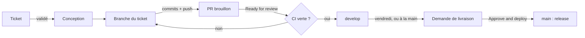

# repowarden

[](https://github.com/simdevWarden/repowarden/actions/workflows/ci.yml)
[](https://github.com/simdevWarden/repowarden/actions/workflows/e2e.yml)
[](https://github.com/simdevWarden/repowarden/releases)
[](https://www.npmjs.com/package/repowarden)
[](https://simdevwarden.github.io/repowarden/)
[](https://scorecard.dev/viewer/?uri=github.com/simdevWarden/repowarden)
[](LICENSE)

**repowarden** garde l'entrée de vos dépôts Git : messages de commit, nommage des branches, secrets, formatage et tests, **quel que soit le langage** — sur les postes (hooks), en CI (GitHub, GitLab) et côté serveur.

📖 **Documentation : https://simdevwarden.github.io/repowarden/** · 🇬🇧 **English: https://simdevwarden.github.io/repowarden/en/**

> **v4 : repogarde devient repowarden** (paquet npm `repowarden`) et lefthook n'est plus pris en charge. Les anciens noms restent lus en v4. Marche à suivre : [Passer à la v4](https://simdevwarden.github.io/repowarden/migration-v4/).

## Ce qu'il fait

- **Commits** : Conventional Commits imposés, préfixe déduit de la branche ; assistant interactif `git cc` (en-tête, corps, pied).
- **Branches** : format `<type>/<sujet>`, commande de renommage proposée, branches mergées supprimées automatiquement.
- **Secrets** : gitleaks avant le commit et en CI.
- **Formatage** : seul le contenu stagé, avec l'outil du projet ; le travail en cours est préservé.
- **Tests** : au push et en CI, seulement les projets touchés, sur le commit poussé.
- **Code mort** : seul le nouveau code mort est signalé, prouvé (bloquant) ou candidat (à vérifier) ; `repowarden code-mort` en local.
- **Tickets** : chaque PR est reliée à un ticket validé (créé automatiquement s'il manque), suivi de « à valider » à « done » à la release ; `repowarden tickets init`.
- **Versions et releases** : les commits étant conventionnels, la version suivante (semver) et le changelog se déduisent de l'historique ; un workflow réutilisable en fait des releases automatiques (PR de release validée par la CI puis mergée, tag, release), sans jeton ; dans le flux `develop` → `main`, un clic d'approbation par livraison.

**Plus de 25 technologies** : Java (Maven, Gradle), JavaScript / TypeScript, Python, Go, Rust, PHP, Ruby, .NET, Dart / Flutter, Swift, Elixir, C / C++, Shell, Terraform, Packer, Ansible, Helm, Kubernetes, Docker, GitHub Actions — [détail](https://simdevwarden.github.io/repowarden/technologies/). Linux, macOS, Windows.

## Le cycle d'une modification

De l'idée à la production, chaque changement suit le même chemin. Tu n'agis qu'aux étapes **en gras** ; le reste est automatique, et chaque étape est vérifiée par la CI.



| # | Étape | Qui | Ce qui se passe | Statut du ticket |
|---|---|---|---|---|
| 1 | Ouvrir un ticket (issue) | toi | rien ne se code sans ticket | à valider |
| 2 | **Valider le ticket** | toi | étiquette `validé` (posée d'office si un mainteneur ouvre le ticket) | backlog |
| 3 | **Écrire la conception** | toi | commentaire « Conception retenue » sur le ticket : ce qui change, fichiers touchés, hors périmètre. Sans elle, la vérification `ticket` de la PR échoue | backlog |
| 4 | **Prendre le ticket** | toi | `repowarden ticket 12` : assigné, branche `fix/12-sujet` créée depuis `develop` | en cours |
| 5 | Coder et committer | toi | `git cc` ; les hooks vérifient message, branche, secrets, formatage, puis les tests au push | en cours |
| 6 | Premier push | auto | PR **brouillon** vers `develop` ouverte, titre et description tirés du ticket | en cours |
| 7 | **Sortir du brouillon** | toi | bouton *Ready for review* (`gh pr ready`) | en relecture |
| 8 | Vérifier et intégrer | auto | CI complète ; verte → **merge automatique** (squash) dans `develop`. Rouge → corriger et pousser, retour en 5 | préprod |
| 9 | Préversion | auto | chaque soir si `develop` a changé : `vX.Y.Z-next.N` (paquet `repowarden@next`), pour tester avant la prod | préprod |
| 10 | Demande de livraison | auto | le vendredi matin, ou à la main (*Actions → release → Run workflow*, ou étiquette `urgent` sur une PR `fix/…`) : instantané `livraison/vX.Y.Z` et sa PR vers `main` | préprod |
| 11 | **Approuver la livraison** | toi | sur la page du run : **Review deployments → Approve and deploy** (pas « Approve » sur la PR, qui est une simple relecture) | préprod |
| 12 | Publier | auto | la GitHub App merge vers `main` : tag `vX.Y.Z`, release, paquet npm, documentation | done, ticket fermé |

Seul `develop` entre dans `main`, et jamais sans l'approbation de l'étape 11. Une PR `develop` → `main` ouverte à la main est fermée automatiquement, avec la marche à suivre. Pas à pas, commandes et pièges : [où cliquer](https://simdevwarden.github.io/repowarden/validation/#ou-cliquer).

## Démarrage

### 1. Sur ton poste, en une minute (tous tes dépôts)

```bash
npm install -g repowarden      # 1. le paquet (yarn global add, pnpm add -g : idem)
repowarden install --global    # 2. active les hooks : demande la langue, installe git cc
repowarden                     # 3. vérifie : état du poste et étape suivante
```

L'étape 2 est indispensable : par sécurité, le paquet n'exécute rien à l'installation (aucun script `postinstall`, que npm 12 bloque d'ailleurs). Ensuite, dans **n'importe quel dépôt**, les hooks s'appliquent dès le prochain commit. Rien n'est ajouté aux projets ni à leur `package.json`.

```bash
cd mon-projet
git switch -c feat/panier            # nom de branche vérifié
git add . && git cc                  # assistant : type, scope, description… puis commit
git push -u origin feat/panier       # tests des projets touchés avant l'envoi
repowarden code-mort                 # nouveau code mort de ta branche
```

| Action | Commande |
|---|---|
| État du poste, étape suivante | `repowarden` (ou `repowarden statut`) |
| Toutes les commandes | `repowarden --help` (`cc`, `code-mort`, `proteger`, `npm-publication`…) |
| Mettre à jour | `npm update -g repowarden` (les hooks suivent) |
| Tester la prochaine version | `npm install -g repowarden@next` (retour : `repowarden@latest`) ; en CI : `uses: simdevWarden/repowarden@develop` |
| Désinstaller | `repowarden uninstall --global`, **puis** `npm uninstall -g repowarden` (dans cet ordre : npm n'exécute rien à la désinstallation, les hooks resteraient branchés sur un dossier supprimé) |

Sans Node : `git clone https://github.com/simdevWarden/repowarden.git ~/repowarden && ~/repowarden/install.sh --global` (mise à jour : `git -C ~/repowarden pull`).

**Nouvelle machine** : ces trois commandes suffisent. Les règles du dépôt, l'environnement de livraison, la GitHub App, ses secrets et la publication npm vivent sur GitHub et npm : rien à reconfigurer. La clé privée de l'App ne doit jamais se trouver sur un poste.

> [!NOTE]
> **GitHub CLI (`gh`) : facultatif.**
> Sans `gh` : tous les hooks (commits, branches, secrets, formatage, tests), `git cc`, `repowarden code-mort`, `repowarden statut`, et la CI (GitHub ou GitLab), qui n'utilise jamais le `gh` du poste.
> Avec `gh` connecté (`gh auth login -s workflow` : le scope `workflow` autorise la modification de `.github/workflows/`), en plus : les tickets (`repowarden ticket`, `tickets`, branches de tes tickets créées en local) et la gestion du dépôt (`proteger`, `app init`, `npm-publication`, `pr-*`, `run-*`). Utile au mainteneur du dépôt GitHub ; chaque commande le signale s'il manque.

### 2. Dans un projet d'équipe : les mêmes règles pour tous

Chaque personne de l'équipe installe repowarden une fois sur son poste (partie 1).

**Sur GitHub, en une commande** : dans le projet, `repowarden bots` (aussi proposé par `repowarden install`) configure les bots du dépôt, avec ton accord pour chacun : CI, releases, nettoyage des branches, tickets, GitHub App, protection, npm. Il demande le flux (`main` seule, ou `develop` → `main`), montre l'aperçu, puis attend ta confirmation ; un fichier existant n'est jamais écrasé.

**À la main**, le projet ajoute deux fichiers, à copier depuis [`templates/project/`](templates/project) :

| Fichier | Rôle |
|---|---|
| [`.github/workflows/repowarden.yml`](templates/project/.github/workflows/repowarden.yml) | la CI refait toutes les vérifications sur chaque PR : c'est elle qui fait foi, même si quelqu'un contourne les hooks (`git commit --no-verify`) |
| [`.repowarden.conf`](templates/project/.repowarden.conf) | réglages communs à toute l'équipe, dont la version minimale de repowarden attendue sur les postes |

L'essentiel des deux fichiers :

```yaml
# .github/workflows/repowarden.yml : vérifications de la PR (dernière version 4.x)
- uses: simdevWarden/repowarden@v4
  with: { strict: true }      # un outil manquant fait échouer la CI
```

```ini
# .repowarden.conf : un poste en retard est prévenu, avec la commande de mise à jour
[repowarden]
    version = 4
```

Puis rendre la CI obligatoire pour merger (`gh` connecté, admin du dépôt) :

```bash
repowarden proteger --checks "repowarden,tests"   # toutes les vérifications exigées, séparées par des virgules
repowarden proteger --checks "repowarden,tests" --verifier   # plus tard : règles en ligne à jour ? (lecture seule)
```

Toujours passer **toutes** les vérifications à `--checks` : sans lui, seule `repowarden` reste exigée. Avec un flux `develop` → `main`, `proteger` crée aussi l'étiquette `urgent` et exige l'approbation de chaque livraison : utiliser le [modèle de release du flux develop](https://simdevwarden.github.io/repowarden/releases/), sinon `main` attendrait un déploiement que rien ne crée (`proteger` le signale).

Exemple complet : [repowarden-demo](https://github.com/simdevWarden/repowarden-demo) · Releases automatiques : [documentation](https://simdevwarden.github.io/repowarden/releases/).

### 3. GitHub App pour l'automatisation (merge auto, tickets, releases)

Pour que les workflows déclenchent les autres workflows (merge auto, tickets, releases), il faut une GitHub App au lieu du `GITHUB_TOKEN` :

```bash
repowarden app init
```

1. Ouvre la page locale → clique « Create GitHub App » sur GitHub
2. Clique « Install » sur ton dépôt ou ton organisation
3. Les secrets `REPOWARDEN_APP_CLIENT_ID` / `REPOWARDEN_APP_KEY` sont configurés automatiquement

Sans cette étape, le `GITHUB_TOKEN` des Actions est utilisé : **ce qu'il fait ne déclenche pas les autres workflows** (merge auto, tickets, préversions).

### 4. Contribuer à repowarden

```bash
git clone https://github.com/simdevWarden/repowarden.git && cd repowarden
./install.sh                         # repowarden se vérifie lui-même (hooks de ce dépôt)
brew install shellcheck bats-core actionlint gitleaks   # outils des vérifications (ou équivalent Linux)
bats test/                           # tests, aussi lancés au push
```

Les PR visent `develop` ; `main` ne reçoit que les livraisons, qui déclenchent les releases. Tout part d'un ticket : voir [AGENTS.md](AGENTS.md) et [CONTRIBUTING.md](CONTRIBUTING.md). Les problèmes se signalent en [issue](https://github.com/simdevWarden/repowarden/issues).

**Dans VS Code** : l'extension [repowarden-vscode](https://github.com/simdevWarden/repowarden-vscode) guide la rédaction des commits, signale une branche mal nommée et des hooks inactifs. En attendant sa publication sur le Marketplace : `.vsix` dans ses [releases](https://github.com/simdevWarden/repowarden-vscode/releases), puis `code --install-extension repowarden-X.Y.Z.vsix`.

## Liens

[Démarrage rapide](https://simdevwarden.github.io/repowarden/demarrage/) · [Hooks et règles](https://simdevwarden.github.io/repowarden/hooks/) · [Technologies](https://simdevwarden.github.io/repowarden/technologies/) · [Configuration](https://simdevwarden.github.io/repowarden/configuration/) · [CI](https://simdevwarden.github.io/repowarden/ci/) · [Versions et releases](https://simdevwarden.github.io/repowarden/releases/) · [Validation humaine](https://simdevwarden.github.io/repowarden/validation/) · [Code mort](https://simdevwarden.github.io/repowarden/code-mort/) · [En organisation](https://simdevwarden.github.io/repowarden/industrialisation/) · [Sources internes (Nexus, Artifactory)](https://simdevwarden.github.io/repowarden/industrialisation/#8-sources-internes-reseau-ferme-nexus-artifactory) · [Désinstallation](https://simdevwarden.github.io/repowarden/desinstallation/) · [Sécurité](SECURITY.md) · [Contribuer](CONTRIBUTING.md) · [Changelog](CHANGELOG.md)

Licence [GPL-3.0-only](LICENSE) : GNU General Public License version 3.
